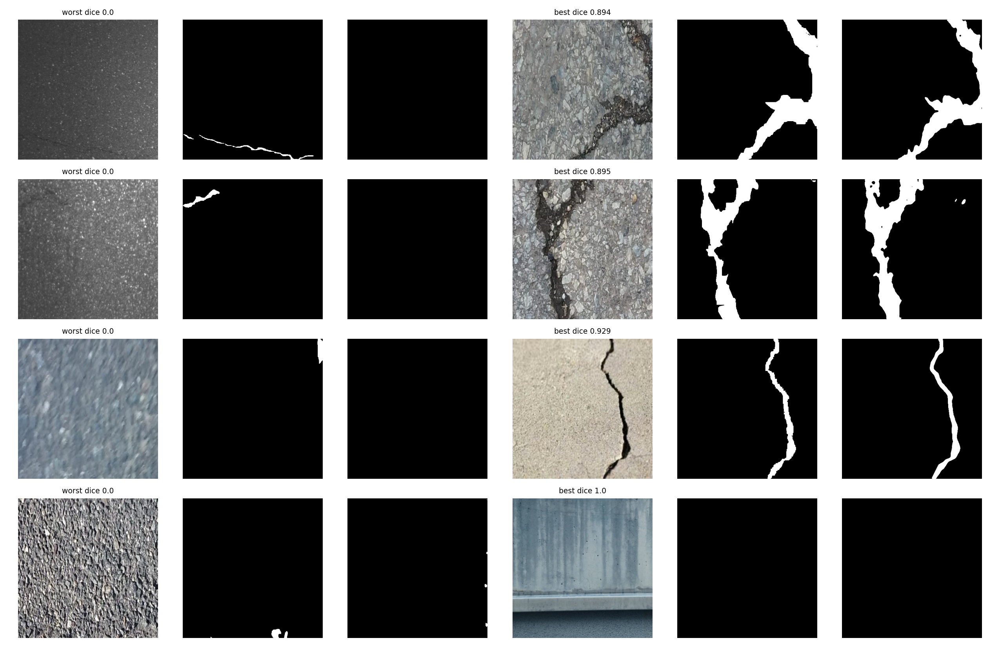
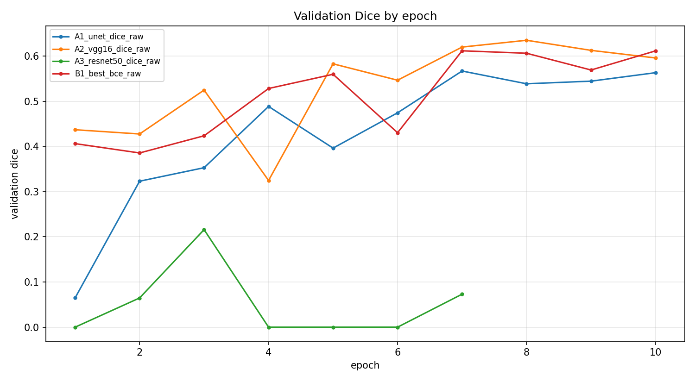

# Cross-Surface Generalization in U-Net Based Crack Segmentation

**CSE463 Computer Vision · Section 03 · Group 03 · Summer 2026 · BRAC University**
Supervised by Dr. Md. Ashraful Alam

**Authors:** Zawad Ahsan, Yeamin Alam

📄 [Paper (PDF)](paper/CSE463_Sec3_G03_paper.pdf) · 💻 [Notebook](notebooks/01_crack_segmentation_project.ipynb) · 📊 [Slides](presentation/CSE463_Sec3_G03_slides.pptx) · 📦 [Trained models & presentation video (Release)](../../releases/tag/v1.0)

---

## Overview

Automated crack segmentation labels each pixel of an image as *crack* or *background*, supporting road and structural inspection. Prior work usually changes the architecture while keeping the training setup fixed, and evaluates on splits that mix every surface type into both training and test data.

This study asks two questions:

1. **How much do the encoder, loss function and input preprocessing matter?**
2. **How far does performance fall on a surface type never seen during training?**

We answer them with a staged ablation of **12 training runs** on a merged dataset of **11,298 images** (448×448) with pixel masks. Crack pixels cover only **3.67%** of the image area, a background-to-crack ratio of **26.23 : 1**.

## Key Findings

- **Best model:** VGG16-UNet with Dice loss and raw RGB input reaches **0.6707 test Dice** (0.6734 with another seed).
- **Pretraining helps:** VGG16 encoder beats a scratch U-Net by +0.073 Dice. ResNet50-UNet underperforms (0.2246) under the fixed training budget.
- **BCE does not collapse** despite the 26:1 imbalance; it trades recall for precision and trails Dice loss by 0.027.
- **Tversky loss** (β = 0.7) matches Dice loss in Dice but gives the highest recall (0.7613), useful when a missed crack costs more than a false alarm.
- **CLAHE and edge-enhanced inputs do not help** this encoder.
- **Cross-surface gap:** holding out a surface family drops Dice to **0.1704 (wall)** and **0.2103 (pavement)**. A size-matched control reaches 0.6611, so the gaps of **0.4907** and **0.4508** come from domain shift, not training-set size.
- **Test-set leakage:** 48 of the 1,695 official test images are exact copies of training images. All reported scores use the clean set of 1,647 test images.

## Results

### Protocol A: Ablation (1,647 deduplicated test images)

| Run | Architecture | Loss | Input | Dice | IoU | Precision | Recall |
|---|---|---|---|---|---|---|---|
| A1 | U-Net (scratch) | Dice | raw | 0.5980 | 0.4265 | 0.5632 | 0.6373 |
| **A2** | **VGG16-UNet** | **Dice** | **raw** | **0.6707** | **0.5045** | 0.6437 | 0.6999 |
| A3 | ResNet50-UNet | Dice | raw | 0.2246 | 0.1265 | 0.1351 | 0.6674 |
| B1 | VGG16-UNet | BCE | raw | 0.6436 | 0.4745 | **0.6807** | 0.6104 |
| B2 | VGG16-UNet | Tversky | raw | 0.6651 | 0.4983 | 0.5905 | **0.7613** |
| C1 | VGG16-UNet | Dice | CLAHE | 0.6317 | 0.4617 | 0.5747 | 0.7012 |
| C2 | VGG16-UNet | Dice | edge | 0.6538 | 0.4856 | 0.6228 | 0.6880 |
| E1 | VGG16-UNet (seed 101) | Dice | raw | 0.6650 | 0.4981 | 0.6484 | 0.6825 |
| E2 | VGG16-UNet (seed 202) | Dice | raw | 0.6734 | 0.5076 | 0.6690 | 0.6779 |

### Protocol B: Cross-Surface Generalization (VGG16-UNet, Dice, raw)

| Run | Setting | Train size | Test size | Dice | Gap vs. D3 |
|---|---|---|---|---|---|
| D1 | Wall held out | 4,054 | 4,864 | 0.1704 | 0.4907 |
| D2 | Pavement held out | 4,578 | 4,248 | 0.2103 | 0.4508 |
| D3 | Size-matched control | 4,054 | 4,864 | 0.6611 | n/a |

Full numbers are in [`results/tables/`](results/tables).

<p align="center">
  <br>
  <em>Four worst and four best predictions (input · ground truth · prediction).</em>
</p>

<p align="center">
  <br>
  <em>Validation Dice by epoch for A1, A2, A3 and B1.</em>
</p>

## Method Summary

- **Dataset:** merged [Kaggle crack segmentation dataset](https://www.kaggle.com/datasets/lakshaymiddha/crack-segmentation-dataset) (CRACK500, DeepCrack, CFD, GAPS384, cracktree200, Rissbilder, Volker and others, plus non-crack images), audited for duplicates and leakage.
- **Architectures:** scratch U-Net, VGG16-UNet, ResNet50-UNet (ImageNet-pretrained encoders).
- **Losses:** Dice, binary cross-entropy, Tversky (β = 0.7).
- **Inputs:** raw RGB, CLAHE, edge-enhanced.
- **Training:** random 128×128 crops, batch 48, Adam. Pretrained encoders are frozen for epochs 1–3 (lr 1e-3), then unfrozen (lr 1e-4). Fixed budget of 150 steps × max 10 epochs, with ReduceLROnPlateau and EarlyStopping on validation Dice.
- **Evaluation:** full 448×448 images, threshold 0.5, pooled pixel counts.
- **Hardware:** Google Colab, NVIDIA Tesla T4, TensorFlow 2.20 / Keras, mixed precision (float16).

## Reproducing the Experiments

All code is in [`notebooks/01_crack_segmentation_project.ipynb`](notebooks/01_crack_segmentation_project.ipynb), built for **Google Colab** with a T4 GPU. It builds the data pipeline, trains all 12 runs, and produces the result tables and figures.

1. Open the notebook in Colab and select a GPU runtime.
2. Add your Kaggle credentials as Colab secrets named `KAGGLE_USERNAME` and `KAGGLE_KEY` (🔑 icon in the left sidebar). The notebook downloads the dataset itself.
3. The notebook mounts Google Drive and writes models, tables and figures to `MyDrive/cse463/`.
4. It expects the dataset audit output (`audit_results.json`) on Drive, produced by the companion audit notebook (`00_data_audit.ipynb`, not included). A copy of that output is in [`results/audit_results.json`](results/audit_results.json).
5. Run all cells. A run registry on Drive records finished runs, so after a Colab disconnect you can rerun the notebook and completed runs are skipped.

Dependencies are listed in [`requirements.txt`](requirements.txt); Colab already provides everything except `kaggle`.

## Repository Structure

```
.
├── notebooks/
│   └── 01_crack_segmentation_project.ipynb  # Full pipeline: data, training, evaluation, figures
├── paper/
│   ├── CSE463_Sec3_G03_paper.pdf      # Final IEEE-format paper
│   └── latex/                         # Overleaf source (main.tex + figures)
├── presentation/
│   └── CSE463_Sec3_G03_slides.pptx    # Presentation slides
├── results/
│   ├── final_summary.json             # Best config, data splits, dedup stats
│   ├── audit_results.json             # Dataset audit (counts, masks, leakage)
│   ├── tables/                        # Per-run metrics, leakage, per-family Dice
│   └── training_history/              # Per-epoch training/validation metrics
└── requirements.txt                   # Python dependencies
```

## Trained Models & Video

The trained models (~223 MB each) and the presentation video (~260 MB) are larger than GitHub's per-file limit, so they are attached to the [**v1.0 Release**](../../releases/tag/v1.0):

| File | Description |
|---|---|
| `A2_vgg16_dice_raw_best.keras` | Best model: VGG16-UNet, Dice loss, raw input |
| `B1_best_bce_raw_best.keras` | VGG16-UNet, BCE loss |
| `D3_size_matched_control_best.keras` | Size-matched cross-surface control |
| `E1_seed_repeat_1_best.keras` | A2 repeated with seed 101 |
| `E2_seed_repeat_2_best.keras` | A2 repeated with seed 202 |
| `Cse463.mp4` | Recorded presentation |

Load a model for inference with Keras (`compile=False` skips the custom loss and metric functions, as the notebook does):

```python
import keras
model = keras.models.load_model("A2_vgg16_dice_raw_best.keras", compile=False)
```

## Acknowledgment

This work was completed for **CSE463 Computer Vision, Section 03, Summer 2026, BRAC University**, under **Dr. Md. Ashraful Alam**.
